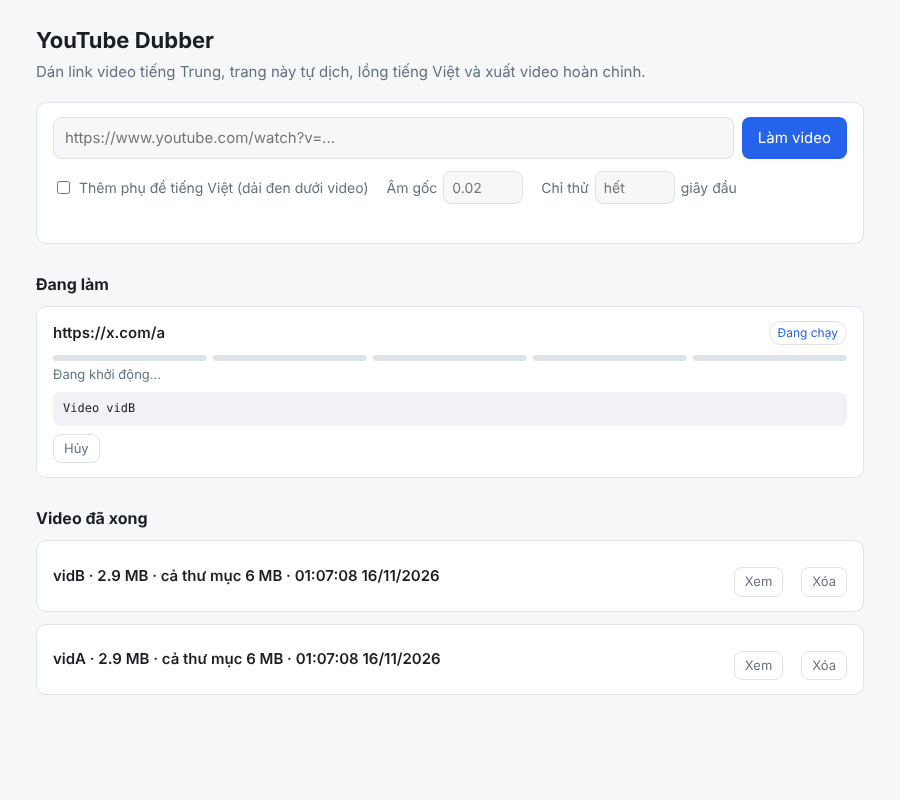
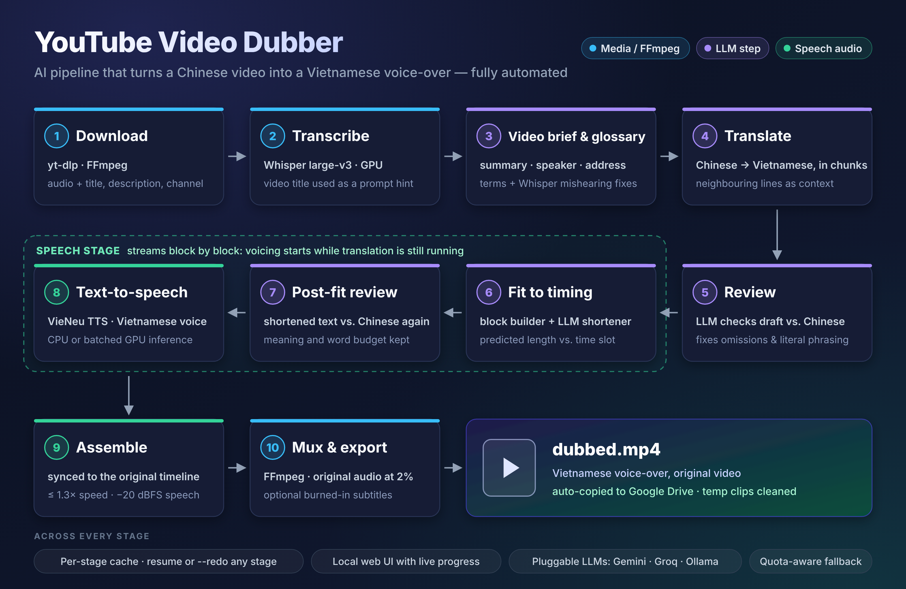

# YouTube Video Dubber (Chinese → Vietnamese)

Dub a Chinese YouTube video into Vietnamese. Give it a link and get back an MP4 with a Vietnamese voice-over (and, if you want, Vietnamese subtitles). I built it to watch Chinese knowledge videos without reading subtitles the whole time.

It is an offline pipeline, not real-time. Speech recognition and the voice run on your own computer; only the translation text goes to an LLM of your choice (Groq, Gemini, or a local Ollama / LM Studio model).



## Features

- One command or one web page: link in, dubbed MP4 out. Finished stages are cached, so an interrupted run resumes where it stopped.
- Speech recognition with faster-whisper `large-v3`, translation in chunks with context, a glossary for names and terms.
- A whole-video brief before translating: the title and description from YouTube, a summary, the speaker, a term sheet, and fixes for words Whisper misheard (e.g. 孙子悲话 -> 孙子兵法).
- Optional review model checks the draft translation and lines shortened for timing, fixing wrong or noticeably unnatural Vietnamese.
- Lines that do not fit their time slot are shortened by the LLM before they are read, so the dub keeps up with the video.
- Local Vietnamese voice (VieNeu v3 Turbo), on the CPU or on an NVIDIA GPU.
- A vertical 9:16 thumbnail (1080x1920, for TikTok / Shorts) taken from the video itself: the sharpest, well-lit frame over a blurred copy of itself, with a white title and a topic line an LLM writes from the video.
- Optional Vietnamese subtitles under the picture, original audio turned down (not removed), queue, cleanup and a "Dịch lại" (translate again) button for finished videos in the local web page.

## Requirements

- **Windows** with Python 3.10+ (the exact versions in `backend/requirements-lock.txt` were tested on Python 3.14). This is the only platform it has been tested on; Linux/macOS may need small changes (for example in `cuda_dlls.py`).
- **An NVIDIA GPU** for Whisper: the code loads `large-v3` on CUDA in float16 (about 3 GB download, roughly 4-5 GB of VRAM). Developed on an RTX 4060 Laptop with 8 GB. Reading the voice on the GPU (`TTS_DEVICE=cuda`) is optional and shares the same card. Without a GPU, change `device` in `pipeline.py` and expect it to be much slower.
- **ffmpeg** and **ffprobe** on your PATH, and **yt-dlp** (installed by pip below).
- An **LLM**: a free Groq or Gemini API key, or a local model through [Ollama](https://ollama.com) or LM Studio (optional).
- About 10 GB of free disk for models, plus space for videos (see [Freeing disk space](#freeing-disk-space)).

## Install

```
git clone https://github.com/xuannhi-tran/youtube-video-dubber.git
cd youtube-video-dubber\backend
python -m venv .venv
.venv\Scripts\activate
pip install -r requirements.txt -c requirements-lock.txt
copy .env.example .env
```

Then put at least one key in `backend/.env` (next section) and run:

```
python dub.py "https://www.youtube.com/watch?v=VIDEO_ID" --max-seconds 120   # try the first 2 minutes
python dub.py "https://www.youtube.com/watch?v=VIDEO_ID"                      # the whole video
```

The result is `backend/dub_jobs_output/<video id>/dub_output/dubbed.mp4`. `dub.py` checks packages, ffmpeg, the key and the local LLM server before it starts and lists what is missing.

### Getting an API key

- **Groq** (free tier): create a key at <https://console.groq.com/keys> and set `GROQ_API_KEY=` in `backend/.env`.
- **Gemini** (free tier): create a key in Google AI Studio, <https://aistudio.google.com/apikey>, and set `GEMINI_API_KEY=`.
- **No key**: use a local model, see [Using a local LLM (Ollama)](#using-a-local-llm-ollama-instead-of-groq).

Free quotas and model names change often and differ per account (some models have only a few requests per day). Check the limits shown in your Groq / AI Studio console, and run `python llm.py --list gemini` to see the exact model names your key can use. When a daily limit is reached the job keeps what it has and continues when you run the same command later.

### Main options

```
python dub.py URL --max-seconds 120         # only the first N seconds
python dub.py URL --subs                    # Vietnamese subtitles under the picture
python dub.py URL --original-volume 0.1     # louder original audio (default 0.02, 0 = off)
python dub.py URL --redo transcribe|speech|mux   # redo from a stage
python dub.py URL --cleanup clips|all       # delete big files after the video is made
python dub.py URL --speaker male|female|auto     # who speaks (forms of address, optional voice per speaker)
```

Everything else is set in `backend/.env`, see [Settings](#settings).

### Web page

```
python web.py          # opens http://127.0.0.1:8765
```

Paste a link, choose the speaker ("Người nói": automatic, male or female), open "Tuỳ chọn nâng cao" for the other options (Vietnamese subtitles, original volume, only the first N seconds) and press the button. Each job shows a progress bar (blocks read so far during the speech stage) and the time it has run, lets you cancel, and plays or downloads `dubbed.mp4` when it is done. Several links wait in a queue and run one after another. If an LLM runs out of its daily limit, the job is marked "Hết limit" (translated chunks are kept) and the queue **stops there** instead of moving on; press "Tiếp tục job này" once the limit is back to continue the same job, or skip it. If only the shortening step hit a limit, the video is still made (the lines that could not be shortened are sped up a little) and the queue waits for "Tiếp tục hàng chờ". The queue lives in memory: closing `web.py` forgets the waiting links (finished videos stay). Finished videos from earlier runs are listed too. Each finished video has a "Dịch lại" button: it runs `dub.py` with `--redo transcribe` on the saved job (translation, review, shortening and voice again from the saved Whisper transcript, using the link saved in `video_info.json`), which is how a new prompt or model reaches a video that is already finished. A failed job shows a short reason and a "Chạy lại" button that continues from the saved steps; its technical log is under "Xem log kỹ thuật". When a review model is set, a finished job lists the reviewed blocks with the first translation next to the final text (after shortening and review).

It runs `dub.py` for you, so everything above applies (resume after an error: paste the same link again; `.env`, glossary). It listens only on this computer (`127.0.0.1`), needs no extra package, and is meant to run on the PC that has the GPU and the keys, not on a public server. Options: `--port 9000`, `--no-browser`. Stop it with Ctrl+C (a running job is stopped too).

## How it works



(Vector version: [docs/architecture.svg](docs/architecture.svg).)

`dub.py` runs five stages for one video. Each video gets its own folder, `backend/dub_jobs_output/<video id>/`, so jobs never mix. Finished stages are skipped on a re-run, so after an interruption (a quota limit, a crash, Ctrl+C) you run the same command and it continues.

```
download -> transcribe + translate  ─┐
                                      ├─ (at the same time) -> assemble -> mux
            speech (shorten + TTS)  ─┘
```

| Stage | Script | What it does |
| --- | --- | --- |
| 1. download | `dub.py` | `yt-dlp` downloads the video (up to 720p by default) to `source.mp4`; `ffmpeg` extracts 16 kHz mono `source.wav`. |
| 2. transcribe + translate | `pipeline.py` | faster-whisper (`large-v3`, on the GPU) transcribes the Chinese speech. One LLM call then reads the whole transcript and writes the video brief (summary, speaker, term sheet, misheard words, which are fixed before translating; see [below](#what-the-translator-knows-about-the-whole-video)). The segments are grouped into windows of about 20 seconds and the LLM translates each window into spoken Vietnamese, with the video brief, the previous 8 translated segments and the next 3 Chinese segments as context. With a review model set, each window is then checked (see [Checking the translation](#checking-the-translation)). Every translated window is saved, so an interrupted run does not redo it. Glossary terms (`glossary.py`) are given to both Whisper (as hotwords) and the LLM. |
| 3. speech | `speech.py` | Starts while translation is still running (`--follow`) and reads blocks as soon as they are translated. Segments are first merged into blocks of about 4-10 s (`dub_block_builder.py`). If a block will not fit its time slot, the LLM shortens it **before** it is read (`fit_blocks.py`); then VieNeu v3 Turbo (voice `xuan_vinh`, on the CPU via ONNX or on the GPU with `TTS_DEVICE=cuda`) reads it and the clip length is measured; a shortened block is checked against the Chinese by the review model (when set) before it is read; a clip that is still too long is shortened once more and read again. The LLM and VieNeu work in parallel, one thread each. |
| 4. assemble | `assemble_dub.py` | Places the clips on the original timeline into `dub_output/dub_track.wav`: trims silence, keeps at least 0.25 s between clips, lets the dub drift up to 3 s from the original, reads slightly faster (up to 1.1x) when more than 1.5 s behind and up to `--max-speed` (1.3x) only to avoid falling more than 3 s behind, and brings every clip to -20 dBFS. |
| 5. mux | `mux_dub.py` | Mixes the dub track with the original audio (original at volume 0.02 by default) into `dub_output/dubbed.mp4`. If the video runs longer than the dub, the original audio returns to full volume after the dub ends. |

Each script also has its own checks that run when it starts (`run_local_checks`), and most can be run alone from inside a job folder by setting `DUB_WORKDIR` to the job folder.

### Freeing disk space

A job keeps many files (clips of every block, audio of the source, the source video). Only `dubbed.mp4` is needed to watch the result, so jobs can clean up after themselves:

```
CLEANUP=clips      # in backend/.env (default: none)
python dub.py URL --cleanup clips            # the same for one run
python cleanup.py JOB_ID --level clips       # clean a finished job by hand (--all-jobs for every job)
```

- `clips` deletes the voice clips and the audio files (the biggest part, often more than the video). `--original-volume` and `--subs` still re-mux in seconds because the source video and the dub track stay.
- `all` also deletes the source video and the dub track: only `dubbed.mp4`, the translation and small files stay. If you ask for something later (`--subs`, `--original-volume`, `--redo`), `dub.py` downloads the video again and reads the voice again from the saved text; it never translates or shortens again.
- Nothing is removed unless the video was finished (`dubbed.mp4` exists).
- On the web page every finished video has a "Xóa" button that deletes its whole folder after a confirmation (not while that video is being made). The list also shows the size of the whole folder.
- `EXPORT_DIR=C:\Users\you\Google Drive\Dubbed` (the folder must exist) copies every finished `dubbed.mp4` there as `<video id>.mp4` (and its thumbnail as `<video id>.jpg`) when its job ends. Point it at a folder that a sync app (Google Drive for desktop, OneDrive, Dropbox) uploads and the video is in the cloud with no extra step; the job folder can then be cleaned or deleted, the copy stays (the web page says which videos have one). `python sync_copy.py` copies the videos that were finished before you set it.

### Redoing a stage

```
python dub.py URL --redo transcribe      # translate again (Whisper's saved transcript is reused)
python dub.py URL --redo speech          # forget earlier rewrites and read again
python dub.py URL --redo mux             # only the last stage
python dub.py URL --original-volume 0.04 # remix with quieter original voice (0 drops it); redoes only the mux
python dub.py URL --subs                 # burn Vietnamese subtitles in (see below); redoes only the mux
python dub.py URL --glossary-only        # create the job folder and glossary.json, then stop
```

`--redo X` redoes stage X and everything after it. On the web page, the "Dịch lại" button of a finished video does `--redo transcribe` for you: use it after a prompt, glossary or model change, because sending the same link again only continues a finished job. Changing `--max-seconds` redoes everything after the download, because the transcript depends on it.

### Files in a job folder

| File | What it is |
| --- | --- |
| `source.mp4`, `source.wav` | Downloaded video and its audio. |
| `glossary.json` | Terms to keep fixed (see [Glossary](#glossary)). Empty by default. |
| `video_info.json` | Title, description and channel from YouTube, and the speaker if you chose one. |
| `video_brief.json` | The whole-video brief (summary, speaker, terms, misheard words). |
| `reference.json` | Your hand-corrected lines for `eval_translation.py` (only if you made one). |
| `transcript_raw.json` | Whisper output (reused while the audio and glossary hotwords are unchanged). |
| `translate_cache.json` | Every translated window, so quota stops cost nothing. |
| `translated_partial.json`, `translated_segments.json` | Growing / final translation. |
| `dub_blocks.json`, `dub_blocks_fitted.json` | Blocks before and after shortening. |
| `block_tts_output/`, `block_tts_duration_results_fitted.json` | The clips and their measured lengths. |
| `speech_state.json`, `dub_state.json` | Progress, so every stage can resume. |
| `dub_output/` | `dub_track.wav`, per-block files, `dub_timeline.json` (when each line is spoken), `dub_subs.ass` (with `--subs`), `thumbnail.jpg` and `dubbed.mp4`. |

Everything under `*_output/`, plus `.env`, audio and video, is git-ignored.

## Setup notes

Install steps and requirements are at the top. Two details: on Windows `nvidia-cublas-cu12` and `nvidia-cudnn-cu12` (in `requirements.txt`) provide the CUDA libraries for Whisper, and `cuda_dlls.py` makes them visible before Whisper loads. `hf_cache_fix.py` works around ONNX Runtime refusing Hugging Face cache symlinks on Windows.

### Vietnamese subtitles

```
python dub.py URL --subs                       # add a black bar under the video with Vietnamese subtitles
python dub.py URL --subs --sub-bar 160         # taller bar (pixels)
python dub.py URL --subs --sub-font-size 40    # bigger text (pixels of the video)
python dub.py URL --subs --sub-font Tahoma     # another installed font
```

The video gets a black bar added **below** the picture, so the original (Chinese) subtitles stay fully visible and the Vietnamese text sits right under them. The text is exactly what the voice reads (after shortening) and appears when that line is actually played in the final dub, taken from `dub_output/dub_timeline.json`. Long sentences are split over several cues of at most two lines.

- Without `--subs` nothing changes: the video is copied as before (fast). With `--subs` the video is re-encoded once (libx264, crf 18), so the mux takes longer and the file is a bit larger.
- On a finished job `--subs` only redoes the last stage. A job made before this option has no `dub_timeline.json`, so the assemble stage is redone too (quick, no LLM or voice).
- Without `--sub-bar` / `--sub-font-size` the sizes are automatic: the bar is about 17% of the video height and the text fits two lines. Vertical (TikTok) videos get a width-limited font size so lines still fit.
- The font must be installed and contain Vietnamese diacritics. The default is Arial (fine on Windows and macOS); if the letters look wrong, set another font.
- Run again without `--subs` and `--redo mux` to get the plain video back.

### Settings

Put them in `backend/.env`. Only a key is required.

```
GROQ_API_KEY=...          # default provider when this is set
GEMINI_API_KEY=...        # used when LLM_PROVIDER=gemini
```

| Variable | Meaning |
| --- | --- |
| `LLM_PROVIDER` | `groq` (default), `gemini`, `ollama` or `lmstudio`. |
| `LLM_MODEL` | Model name; each provider has a default (`openai/gpt-oss-120b` for Groq, `gemini-3.5-flash-lite` for Gemini, `qwen3:8b` for Ollama). |
| `TRANSLATE_LLM_PROVIDER`, `TRANSLATE_LLM_MODEL` | Override the two above for translation only. |
| `FIT_LLM_PROVIDER`, `FIT_LLM_MODEL` | Override them for shortening only (`fit_blocks.py` and `speech.py`). |
| `REVIEW_LLM_PROVIDER`, `REVIEW_LLM_MODEL` | Optional second pass over the translation and a final check of lines shortened for timing: the model reads the Chinese next to the Vietnamese and fixes meaning errors, word-for-word phrasing, or noticeably unnatural Vietnamese (see "Checking the translation" below). Off while `REVIEW_LLM_PROVIDER` is empty. |
| `REVIEW_WORKERS` | Chunks the review pass checks at the same time (1 to 16, default 4). |
| `REVIEW_TIMEOUT` | Seconds a chunk waits for its review before the draft is used (default 150, 0 = no limit). |
| `VIDEO_BRIEF`, `TRANSLATE_TIMING` | The whole-video brief (on, `0` turns it off) and the per-passage time budget (off, `1` turns it on); see [What the translator knows about the whole video](#what-the-translator-knows-about-the-whole-video). |
| `TTS_VOICE_FEMALE`, `TTS_VOICE_MALE` | Voice for videos whose speaker was set with `--speaker female` / `male` (or on the web page); empty keeps `TTS_VOICE`. |
| `TRANSLATE_LLM_REASONING`, `FIT_LLM_REASONING`, `REVIEW_LLM_REASONING` | How hard a Groq or Gemini model may think (`low`, `none`... sent as `reasoning_effort`). Empty keeps the model's default; a value the model does not know makes its requests fail, so remove it if you see errors. |
| `TRANSLATE_FALLBACK_PROVIDER`, `TRANSLATE_FALLBACK_MODEL`, `FIT_FALLBACK_PROVIDER`, `FIT_FALLBACK_MODEL` | If the main translation or shortening LLM runs out of its daily quota, this one takes over for the rest of the run (e.g. `gemini` / `gemini-3.5-flash-lite`, or `ollama` / `qwen3:8b`). Work already done is kept; translations made by the fallback are saved under its name, and `--retranslate` translates them again with the main model. The next run tries the main LLM first again. |
| `LLM_MAX_TOKENS` | Cap on the answer length (some Groq models allow very little per minute). |
| `GROQ_API_URL` | Any OpenAI-compatible chat endpoint instead of Groq's. |
| `GEMINI_RPM` | Requests per minute this process may send to Gemini (default 10, the free Flash Lite limit is 15). |
| `LOCAL_LLM_URL`, `LOCAL_LLM_TIMEOUT`, `LOCAL_LLM_THINK` | Local server settings, see below. |
| `SUB_FONT`, `SUB_FONT_SIZE`, `SUB_BAR` | Defaults for `--subs`: font name (default `Arial`), text size and bar height in pixels (0 = automatic). The command-line options win. |
| `TTS_VOICE` | VieNeu preset voice, default `xuan_vinh` (e.g. `thien_minh`). `python compare_voices.py` lets you listen to every voice. Changing it reads all blocks again (clips are keyed by voice); the speech rate is calibrated per voice. |
| `CLEANUP` | `none` (default), `clips` or `all`: what to delete after a video is made, see [Freeing disk space](#freeing-disk-space). |
| `THUMBNAIL`, `THUMBNAIL_TITLE` | `1` (default) makes the vertical 9:16 thumbnail after each video, `0` turns it off; `THUMBNAIL_TITLE=0` keeps the picture but writes no text on it; `THUMBNAIL_HOOK=1` adds the hook sentence. `THUMBNAIL_LLM_PROVIDER` / `THUMBNAIL_LLM_MODEL` choose the LLM that writes it, `THUMBNAIL_FONT` / `THUMBNAIL_TOPIC_FONT` / `THUMBNAIL_HOOK_FONT` the fonts. See [Vertical thumbnail](#vertical-thumbnail). |
| `EXPORT_DIR` | Folder (e.g. synced to the cloud) that every finished video is copied to, see [Freeing disk space](#freeing-disk-space). |
| `TTS_DEVICE` | `cpu` (default, the ONNX engine) or `cuda` to read on the GPU with PyTorch, about 12 times faster per sentence on an RTX 4060 Laptop (see [Reading on the GPU](#reading-on-the-gpu)). GPU clips are kept apart from CPU clips, so switching reads every block again. |
| `TTS_BATCH` | Blocks read in one pass on the GPU, 1 to 32, default 1 (see [Reading on the GPU](#reading-on-the-gpu)). |

`python llm.py` checks the logic and makes one real call for translation and one for shortening, which is the quickest way to test your settings. `python llm.py --list` lists the models your Groq key can use, `python llm.py --list gemini` the ones your Gemini key can use (copy the name exactly). `python llm.py --limits` sends one tiny request to the Groq translation model (or `--limits MODEL`) and prints the limits Groq reports for your key: requests per day, tokens per minute, and what is left. `backend/.env.example` has every setting with a short comment.

### Vertical thumbnail

After every finished video `dub.py` makes `dub_output/thumbnail.jpg`, a 1080x1920 (9:16) cover for TikTok, Shorts or Reels, in the style of the usual TikTok covers: the frame darkened (darker towards the bottom), a big white upper-case **title** in the middle, and a small upper-case **topic** line under it, all clear of TikTok's caption and buttons (`THUMBNAIL_HOOK=1` adds a gold **hook** sentence lower down; it is off by default). About a dozen frames between 8% and 92% of the video are scored (sharp detail counts, black, washed-out and flat frames do not) and the best one is used, taken from the original video so burned-in subtitles never end up in it. A horizontal video is shown in the middle over a blurred, enlarged copy of itself; a vertical video is cropped to fill the picture.

The texts are written by an LLM from the original title, the video brief and the start of the translation: a title of 4 to 8 words that makes people curious without promising what the video does not say, a topic label of 2 to 5 words and, with `THUMBNAIL_HOOK=1`, one sentence of the video's key idea as the hook. It costs one small request per video, uses the translation LLM (then the review LLM if the first fails; or `THUMBNAIL_LLM_PROVIDER` / `THUMBNAIL_LLM_MODEL`), and the texts are saved in `dub_output/thumbnail_text.json`. If the LLM fails the picture is made without text and the log says so; `THUMBNAIL_TITLE=0` turns the text off. The fonts are bundled in `backend/fonts/` (Be Vietnam Pro Bold and Medium for the title and topic, Lora for the optional hook; SIL Open Font License, all the Vietnamese diacritics), so the cover looks the same on every computer; `THUMBNAIL_FONT`, `THUMBNAIL_TOPIC_FONT` and `THUMBNAIL_HOOK_FONT` choose other installed fonts. The title and topic sit together in the middle of the picture and the title stays on two lines when a slightly smaller font allows it.

```
python thumbnail.py VIDEO_ID                       # make it for a finished video that has none
python thumbnail.py VIDEO_ID --force               # pick the frame and write the texts again
python thumbnail.py VIDEO_ID --redraw              # draw it again with the saved texts (edit thumbnail_text.json first)
python thumbnail.py VIDEO_ID --title "Bốn kiểu tâm lý tiền bạc"   # your own title, the other texts stay
python thumbnail.py VIDEO_ID --no-title            # the picture only
python thumbnail.py --export                       # every video in EXPORT_DIR without a .jpg yet, even if its job was deleted
python dub.py URL --no-thumbnail                   # skip it (or THUMBNAIL=0 in backend/.env)
```

The thumbnail is kept by `CLEANUP` (it is small), copied to `EXPORT_DIR` as `<video id>.jpg` and deleted together with the job folder by the "Xóa" button (the copy in `EXPORT_DIR` stays, like the video). On the web page each finished video shows it, with a link to download it and a "Tạo thumbnail" / "Làm lại thumbnail" button (the second one picks the frame and writes the texts again). It does not detect faces, so on a horizontal video the text can sit over the speaker, and a frame with a person looking away can still win: remake it with `--force`. The faint Chinese characters and the small line at the top that some covers have are not drawn.

### Reading on the GPU

The voice (VieNeu) reads on the CPU by default, slightly slower than real time. With an NVIDIA GPU it is about 12 times faster per sentence (measured on an RTX 4060 Laptop: 4 to 5 s of audio in about 0.4 s instead of 4 to 5 s). In the project venv:

```
pip install -r requirements-gpu.txt -c requirements-lock.txt
python tts_speed_test.py --only cuda     # should print "x real time" well above 1
```

Then put `TTS_DEVICE=cuda` in `backend/.env`. `dub.py` checks at the start that PyTorch sees the GPU. The first GPU run downloads the PyTorch model (a few hundred MB). Notes:

- The torch download is a few GB. Tested with torch 2.11 (cu128) on Python 3.14; vieneu's own `[cuda]` extra pins torch 2.8, which you do not need to follow.
- On the GPU, `transformers` downloads and runs Python code from the Hugging Face repo `OpenMOSS-Team/MOSS-Audio-Tokenizer-Nano` (its version is not pinned). Only enable this if you accept that.
- GPU and CPU voices sound slightly different, so switching device reads every block again (and calibrates the speaking rate again).
- Whisper, Ollama and the voice share the GPU's 8 GB; if you run out of memory, keep `TTS_DEVICE=cpu`, or stop Ollama between runs.
- `TTS_BATCH=8` (1 to 32, default 1) reads several waiting blocks in one GPU pass (about 35 times real time in the test instead of 12). It saves little in practice: the speech stage is mostly waiting for the shortening LLM, so a whole 8-minute video only gains some 25 seconds, and it only helps when many blocks are waiting at once (e.g. reading a finished job again). If a batch fails (e.g. out of GPU memory) the blocks are read one by one.

### Which LLM for what

Translation needs the model to understand context (names, terms, sentence boundaries) and is the stage where small local models struggle most; shortening is many short calls and uses quota quickly. A setup that spreads the free quotas:

```
TRANSLATE_LLM_PROVIDER=groq
TRANSLATE_LLM_MODEL=qwen/qwen3.8-27b
TRANSLATE_FALLBACK_PROVIDER=gemini
TRANSLATE_FALLBACK_MODEL=gemini-3.5-flash-lite
REVIEW_LLM_PROVIDER=gemini
REVIEW_LLM_MODEL=gemini-3.1-flash-lite
FIT_LLM_PROVIDER=groq
FIT_LLM_MODEL=openai/gpt-oss-120b
```

In side-by-side tests Qwen 3.8 27B on Groq translated noticeably more naturally than Gemini Flash Lite, and fast. Groq limits each model separately (by default about 1,000 requests and 200,000 tokens a day, and 8,000 tokens a minute; `python llm.py --limits` shows yours), so Qwen for translation and gpt-oss for shortening do not share a budget. A 20-second window costs a few thousand tokens, so the per-minute limit makes translation wait now and then; that is handled automatically.

with a local Ollama model as the fallback: for shortening, set `FIT_FALLBACK_PROVIDER=ollama` and `FIT_FALLBACK_MODEL=qwen3:8b` and it switches by itself when the main model hits its daily limit (Ollama must be running; `dub.py` warns at the start if it is not). Otherwise, if a stage stops on a daily limit, run again with `TRANSLATE_LLM_PROVIDER=ollama` (or `FIT_LLM_PROVIDER=ollama`); windows already translated by another model are kept. Gemini limits differ a lot between models and accounts (a lite model usually allows far more requests per minute and per day than a full one); check yours in AI Studio and pick the model accordingly. A per-minute limit is waited out automatically; a per-day limit stops the run with a message, keeping everything finished (the free tier resets at midnight Pacific time). Requests are spaced to `GEMINI_RPM`; translation and speech run as separate processes, so keep that in mind if both use Gemini.

### Checking the translation

A small, fast model (for example Gemini Flash Lite) is cheap but may translate some lines word for word, produce awkward Vietnamese, or get the meaning wrong. A second model can check its draft without translating everything again:

```
TRANSLATE_LLM_PROVIDER=gemini
TRANSLATE_LLM_MODEL=gemini-3.5-flash-lite
REVIEW_LLM_PROVIDER=gemini
REVIEW_LLM_MODEL=gemma-4-31b-it
```

For every chunk the review model gets the Chinese and the draft and answers with only the lines to change, so its answer is short. It fixes wrong meaning, word-for-word phrasing, awkward word order, duplicated meaning and stiff expressions while preserving the source meaning and line timing. It is told never to add a person or pronoun the Chinese does not have, never to swap a key word for a vaguer one, never to drop a detail the Chinese has (盲选 keeps "nhắm mắt"), and never to turn a statement into a question or back. In practice it changes about a third of the lines; the log line `review changed X of Y lines` adds a note when it rewrites more than 25% of a chunk, so you know which parts to listen to. A fix is ignored if it is much longer than the draft, has Chinese characters or removes the last sentence end. Chunks are checked in parallel while the next ones are still being translated (`REVIEW_WORKERS`), and `translated_partial.json` only ever holds settled text (reviewed, or the draft when the review gave up). The review never stops the dub: a chunk whose review fails (server error, daily quota) or is not back within `REVIEW_TIMEOUT` seconds of its draft (default 150, 0 = no limit) keeps its draft. After 3 such chunks in a row, or at once on a daily quota, the review is switched off for the rest of the run. Drafts kept this way are not saved as reviewed, so running the same command again reviews them; with an unusable answer the draft is kept too. Reviews are saved in `translate_cache.json`, so running again costs nothing. To compare models on one chunk first, use `python compare_translators.py VIDEO_ID --provider gemini --models a,b`.

### What the translator knows about the whole video

Each chunk is only about 20 seconds, so before translating, `pipeline.py` gives every chunk what the whole video says:

- **Title, description, channel** come from YouTube (`dub.py` saves them in the job's `video_info.json`). Whisper also gets the start of the title, so it hears the topic's names and terms better.
- **Video brief** (`video_brief.json`): one call to the translation model reads the whole transcript and returns a short summary, the speaker as heard, how the audience is addressed, the names and terms with their Vietnamese (Hán Việt for Chinese names, original spelling for foreign ones, usual Vietnamese titles for books), and the words Whisper clearly misheard. Those are fixed in the transcript before it is translated (the log lists them, e.g. `heard 孙子悲话 -> 孙子兵法`, `heard 连坡 -> 廉颇`). The title, summary, speaker and the terms of the passage go into every translation and review prompt. It is saved, so a re-run costs nothing; `VIDEO_BRIEF=0` turns the call off.
- **Speaker**: `dub.py URL --speaker female` (or `male`, or the "Người nói" menu on the web page) tells the translation who speaks, so a woman is never called "anh" or "ông". It is remembered per video (`--speaker auto` forgets it and lets the brief guess). If `.env` has `TTS_VOICE_FEMALE` / `TTS_VOICE_MALE`, that voice reads videos with that speaker instead of `TTS_VOICE`.
- `TRANSLATE_TIMING=1` also tells the translator how many seconds each passage lasts and how many Vietnamese words fit. It is off by default: in a test it made the text 7% shorter but dropped details and flattened metaphors, which the speech stage's line-by-line shortening handles better.

To measure a change instead of guessing, `python eval_translation.py VIDEO_ID --make-reference --from 60 --to 180` copies some lines into `reference.json`; correct them by hand once, then `python eval_translation.py VIDEO_ID` scores the current translation against them (chrF, 0 to 100) and lists the lines furthest from your version. `--candidate a.json --candidate b.json` compares saved versions side by side.

When the speech stage shortens a block to fit its time slot, the same review model checks that fitted text against the Chinese before it is read. It may fix awkward grammar, speaker perspective, or an unnatural literal metaphor, but its answer must stay within the block's word budget. The voice is then synthesized and measured again, so an edited line is not reused from the audio cache. This adds one review request for each block that was shortened; it runs only when `REVIEW_LLM_PROVIDER` is set.


### Glossary

`dub.py` creates an empty `glossary.json` (a JSON list of strings) in each job folder. Edit it **before** the transcribe stage to pin names and terms:

```json
["khí chất", "tạp chí Time", "MBTI", "Fe (cảm xúc hướng ngoại)"]
```

An entry may carry its meaning in parentheses: the LLM explains it once in words and afterwards uses only the term.

An entry can also say what it stands for in the original speech, with `=>`. This is how Chinese names get their Sino-Vietnamese (Hán Việt) reading and how a word gets one fixed translation:

```json
["黄晓明 => Hoàng Hiểu Minh", "吴亦凡|Chris Wu => Ngô Diệc Phàm", "酷盖 => người ngầu", "态度 => thái độ"]
```

`|` separates several spellings of the same source. Such an entry is only given to the LLM for the passages whose original text contains its source (so one entry's term cannot leak into a passage about something else), and its sources are given to Whisper as hotwords, which helps it write the name correctly. Plain entries in Latin letters (MBTI, Fe) are used only where they occur in the original; a plain Vietnamese entry is always given, and the prompt tells the LLM to use it only where the speaker really means it. Without an entry, Chinese names are asked to be written in Hán Việt and foreign names in their original spelling, which a small model does unreliably, so add the names that matter.

If a job has no `glossary.json`, a default list of Bible-related terms from the first demo video is used. Only the glossary entries that apply to a window are part of its cache key, so adding a name does not translate windows again that do not contain it; but adding a source also changes Whisper's hotwords, which re-runs the transcription once.

### Pronunciation

An optional `pronunciations.json` (in `backend/`, or in a job folder to override it) maps text to how it should sound, e.g. `{"ENFJ": "e n f j"}`. It is applied just before reading.

## Using a local LLM (Ollama) instead of Groq

Groq's free tier has a daily token limit. Translation and shortening can instead use a model on your own computer through Ollama or LM Studio. Local models have no quota and no key. Nothing changes unless you set the variables below: the default is still Groq.

**1. Install Ollama and pull a model** (Windows: installer from https://ollama.com/download, then in a terminal):

```
ollama pull qwen3:8b             # recommended, about 5 GB
ollama pull qwen2.5:7b-instruct  # alternative
ollama list                      # check it is there
```

To keep models on another drive, set `OLLAMA_MODELS` (e.g. `setx OLLAMA_MODELS "C:\ollama\models"`), restart Ollama and open a new terminal before pulling.

Both are Q4 builds that fit an 8 GB GPU. Whisper also uses the GPU, but only at the start, and Ollama unloads its model after a few idle minutes, so the stages mostly take turns. If you run out of VRAM, pick a smaller model such as `qwen3:4b`.

**2. Choose it in `backend/.env`:**

```
# everything local
LLM_PROVIDER=ollama
LLM_MODEL=qwen3:8b

# or mix: translate with Groq, shorten locally (shortening is many short calls)
FIT_LLM_PROVIDER=ollama
FIT_LLM_MODEL=qwen3:8b
```

| Variable | Meaning |
| --- | --- |
| `LOCAL_LLM_URL` | Default `http://localhost:11434/v1` (Ollama) or `http://localhost:1234/v1` (LM Studio). |
| `LOCAL_LLM_TIMEOUT` | Seconds to wait for one answer (default 600). |
| `LOCAL_LLM_THINK` | `1` lets Qwen3 reason before answering; off by default because it is slow. |

LM Studio: load a model, start the server in the Developer tab, set `LLM_PROVIDER=lmstudio` and `LLM_MODEL` to the identifier shown there.

**3. Run it**

```
python llm.py
python dub.py "https://www.youtube.com/watch?v=VIDEO_ID" --max-seconds 120
python compare_translators.py JOB_ID --provider ollama --models qwen3:8b,qwen2.5:7b-instruct
```

**What to expect from 7-8B models**

- Their JSON is less reliable. The parser accepts code fences, `<think>` blocks, chatter around the array, trailing commas and an answer cut off before `]`. A bad answer is asked again with a note on what was wrong, and a window that still fails is split in two halves. If it still fails, the run stops and the finished windows are kept.
- A translation that still contains Chinese characters is treated as wrong and asked again (the voice cannot read them); a single segment that still has some after all retries has those characters removed.
- Windows already translated by another model are kept when you switch (same transcript, glossary and prompt version). `pipeline.py --retranslate` translates them again with the current model.
- Names and terms are weaker than with Groq: use the glossary. Speech-recognition mistakes in names are sometimes translated literally.

## Other scripts

| Script | Use |
| --- | --- |
| `web.py` | The local web page described above (`web_ui.html` is its page). |
| `cleanup.py` | Frees disk space of finished jobs, see [Freeing disk space](#freeing-disk-space). |
| `thumbnail.py VIDEO_ID` | Makes (or remakes) the vertical thumbnail of a finished video, see [Vertical thumbnail](#vertical-thumbnail). |
| `sync_copy.py` | Copies finished videos to `EXPORT_DIR` (those not copied yet). |
| `compare_translators.py JOB_ID` | Translates the same window of a job with several models, side by side, into `translator_compare_output/`. |
| `eval_translation.py JOB_ID` | Scores a job's translation against a reference you corrected by hand (chrF), see above. |
| `run_checks.py` | Runs every module's built-in checks (no GPU, keys or network needed); GitHub Actions runs it on every push and pull request. |
| `video_brief.py` | The whole-video brief used by `pipeline.py`; run alone it checks its own logic. |
| `compare_voices.py` | Reads a sample with every VieNeu preset voice and writes an `index.html` to listen and compare. |
| `tts_speed_test.py` | Measures VieNeu speed on CPU vs GPU. |
| `fit_blocks.py` | The shortening step on its own. Dry run by default; `--apply` calls the LLM. `speech.py` uses it too. |
| `test_block_tts_duration.py`, `test_tts_duration.py`, `analyze_tts_silence.py` | Benchmark and silence analysis of clips; `speech.py` reuses their helpers. |

## Limitations

- Tested end to end on Windows with Groq and Gemini, and on a short clip with a local Ollama model. Not tested on other languages or other operating systems. Translation quality with a 7-8B local model is clearly below Groq's `gpt-oss-120b`.
- Chinese → Vietnamese only, one VieNeu voice per run (`xuan_vinh` by default, see `TTS_VOICE`).
- The original audio is only turned down, not removed: voices are not separated from music. Use `--original-volume` to taste (0 drops it).
- VieNeu on CPU is slow, so a long video takes a long time to read; `TTS_DEVICE=cuda` reads on the GPU (see above), but still one block at a time.
- Whisper needs a CUDA GPU. Without one, change `device` in `pipeline.py` (slower).
- Vietnamese is longer than Chinese in the same time, so some blocks are shortened by the LLM, which can lose detail; some blocks over about 12 s have no sentence break to split at. Timing is kept by letting the dub drift (up to 3 s) and by small speed-ups rather than exact sync.
- The Groq free tier stops at its daily limit; the run keeps what it has and continues when you run the same command later.
- Quality depends on the LLM and on speech-recognition errors. Check the result before sharing it.

## Notes on content and safety

- **Copyright.** Dub only videos you own or have permission to use. Downloading and re-publishing someone else's video, even dubbed, can infringe their copyright and break YouTube's terms. Credit the source and ask the creator before you publish anything.
- **AI voice and translation.** The voice is synthetic and the translation can contain mistakes. Check the result before sharing, and say it is AI-dubbed.
- **Remote code on the GPU.** With `TTS_DEVICE=cuda`, `transformers` downloads and runs Python code from the Hugging Face repo `OpenMOSS-Team/MOSS-Audio-Tokenizer-Nano` (version not pinned). Enable it only if you accept that. The default CPU mode does not do this.
- **Web page.** `web.py` listens only on `127.0.0.1` and checks the Host/Origin headers. Do not expose it to a network: it can start jobs and use your API keys.
- **API keys** live only in `backend/.env`, which is git-ignored. Never commit it.

## Third-party components and licenses

This project is MIT-licensed (see `LICENSE`). It uses, but does not include, these components, each under its own license. Check the current terms before you redistribute or use the output commercially.

| Component | Used for | License |
| --- | --- | --- |
| [VieNeu-TTS](https://github.com/pnnbao97/VieNeu-TTS) v3 Turbo and its preset voices (including `xuan_vinh`) | Vietnamese speech | Apache-2.0. Keep the license notice and credit the VieNeu-TTS authors; do not use the voices to clone a real person without their permission. |
| [faster-whisper](https://github.com/SYSTRAN/faster-whisper) with OpenAI Whisper `large-v3` | Speech recognition | MIT (code), Apache-2.0 (model) |
| [yt-dlp](https://github.com/yt-dlp/yt-dlp) | Downloading videos | Unlicense |
| [ffmpeg](https://ffmpeg.org) | Audio and video processing | LGPL/GPL, depending on your build; installed separately |
| Be Vietnam Pro, Lora (fonts in `backend/fonts/`) | Thumbnail text | SIL Open Font License 1.1 (copies of the licenses are in the same folder); they may be bundled and redistributed |
| Gemma 4, Qwen3 (optional LLMs) | Translation, review, shortening | Apache-2.0 for the open weights; using them through Groq or Gemini is also subject to those services' terms |

